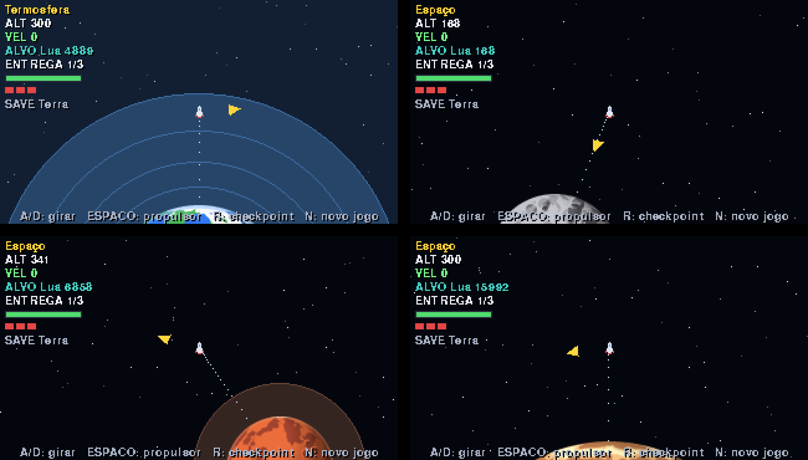

# Rocket Simulator 🚀

Jogo 2D de entrega espacial em **Python + Pygame**, com visual pixelado. Você pilota um foguete que decola da Terra, atravessa as camadas da atmosfera e leva cargas de planeta em planeta, driblando meteoros e administrando combustível.

O projeto nasceu como um exercício de **Programação Orientada a Objetos** e foi evoluindo de uma simulação de física em texto para um jogo jogável.



## Objetivo do projeto

Praticar POO em Python de um jeito que eu consiga *ver* funcionando. Em vez de modelar um sistema abstrato (conta bancária, biblioteca...), escolhi modelar coisas físicas que interagem entre si: um foguete, seus motores, um tanque de combustível e os astros ao redor. Quando a modelagem está certa, o comportamento aparece na tela. Quando está errada, o foguete explode na Lua.

## Como jogar

| Tecla | Ação |
|---|---|
| `A` / `D` ou `←` / `→` | Girar o foguete |
| `Espaço` (ou `↑` / `W`) | Ligar o propulsor |
| `R` | Voltar ao último checkpoint |
| `N` | Novo jogo |

**Missão:** entregar a carga na Lua, depois em Marte e por fim em Júpiter.

- A **seta amarela** aponta direto para o alvo. A **linha pontilhada ciano** é a rota sugerida, mas você pode escolher outro caminho.
- Os **pontos brancos** mostram para onde você iria com os motores desligados (a gravidade dos astros curva a trajetória).
- Para **pousar**, chegue com velocidade **≤ 30** e com o bico apontando para longe do astro (até ~37° de inclinação). Fora disso, o foguete é destruído.
- **Meteoros** aparecem no espaço (a atmosfera os queima). O foguete aguenta 3 impactos.
- **Latas de combustível** ficam espalhadas perto da rota, e a Terra funciona como base de reabastecimento.
- Todo **pouso suave** vira um checkpoint.
- A **atmosfera da Terra** tem camadas (troposfera, estratosfera, mesosfera e termosfera) que freiam o foguete. Quanto mais alto, menos ar.

## Como rodar

```bash
pip install pygame
python main.py
```

As texturas dos planetas ficam em `assets/planets/`. Se estiverem faltando, o jogo tenta gerá-las sozinho (precisa de `numpy` e `pillow`):

```bash
pip install numpy pillow
python tools/gerar_planetas.py
```

Para rodar os testes:

```bash
pip install pytest
python -m pytest
```

## Estrutura

```
rocket-simulator/
├── main.py                  # inicia o jogo
├── assets/planets/          # sprites dos astros (gerados por código)
├── tools/
│   └── gerar_planetas.py    # gerador procedural das texturas
├── tests/
│   └── test_rocket.py
└── rocket_simulator/
    ├── game.py              # loop, câmera, HUD e desenho
    └── entities/            # as regras do jogo
        ├── rocket.py
        ├── motor.py
        ├── tank.py
        └── world.py
```

A pasta `entities` guarda a lógica e a física. O `game.py` só desenha e lê o teclado. Essa separação é proposital: dá para trocar o visual (por exemplo, para 3D) sem mexer nas regras.

## Entidades (POO)

| Classe | Responsabilidade |
|---|---|
| `Tank` | Guarda o combustível. Valida capacidade e quantidade, fornece e reabastece sem passar do limite. |
| `Motor` | Produz aceleração e consome combustível do tanque. Estados: `OFF`, `RUNNING`, `OUT_OF_FUEL`. |
| `Rocket` | **Compõe** motores e um tanque. Cuida de posição, velocidade, ângulo, gravidade, arrasto, pouso e batida. Estados: `LANDED`, `FLYING`, `CRASHED`. |
| `CorpoCeleste` | Planeta ou lua: gravidade, raio, atmosfera em camadas e densidade do ar por altitude. |
| `Meteoro`, `Combustivel` | Obstáculo e item de recarga. |
| `Missao` | A rota de entregas: origem, alvo atual e progresso. |

## O que aprendi

- **Cada classe com uma responsabilidade.** O `Tank` não sabe nada de motores e o `Motor` não sabe nada de física. Isso deixou fácil trocar o `Rocket` por inteiro (de "voo reto até um destino" para "voo livre com gravidade") sem tocar em `Tank` nem `Motor`.
- **Composição.** Um `Rocket` *tem* motores e um tanque em vez de herdar deles. Dá para criar foguetes diferentes só mudando as peças.
- **Encapsulamento e validação.** Os construtores recusam valores inválidos com `ValueError` e `TypeError`, e o `Tank.refuel` nunca ultrapassa a capacidade. O objeto protege o próprio estado.
- **Estados explícitos.** Usar um `status` (`LANDED`, `FLYING`, `CRASHED`) torna as regras fáceis de ler: o que pode acontecer em cada situação fica claro.
- **Separar lógica de apresentação.** A física não depende do Pygame, então dá para testá-la sozinha.
- **Testes automatizados com `pytest`.** Fixtures e testes de comportamento: decolar, não decolar sem combustível, pouso suave, pouso brusco e dano acumulado. Os testes me deram segurança para reescrever o `Rocket`.
- **Refatorar com cuidado.** Remover código morto, reescrever uma classe mantendo as outras e atualizar os testes junto.
- **Física de jogo.** Gravidade pela lei do inverso do quadrado, arrasto proporcional à densidade do ar e integração passo a passo (Euler semi-implícito).
- **Arte gerada por código.** As texturas dos planetas usam ruído procedural, sombreamento em 4 tons e *dithering*, sem nenhuma imagem desenhada à mão.
- **Git no dia a dia.** Commits pequenos, branch de feature, `--amend`, `reset --soft` e `rebase -i`.

## Próximos passos

- [ ] Salvar o checkpoint em arquivo (JSON) para continuar depois
- [ ] Atmosfera mais suave e nome do alvo marcado na tela
- [ ] Ajustar a dificuldade com base em partidas reais
- [ ] Mais planetas e entregas
- [ ] Versão 3D

## Gamificação da POO e uso de IA

**Gamificando a POO.** Transformei o exercício de POO em um jogo para ter um retorno imediato do que modelei: cada classe virou uma mecânica que dá para ver e jogar.

- `Tank` e `Motor` viraram a gestão de combustível: gastar, recarregar e ficar sem.
- `Rocket` virou a pilotagem, com estados de voo, pouso e batida.
- `CorpoCeleste` virou gravidade, atmosfera em camadas e arrasto.
- `Missao` virou o objetivo do jogo: rota, entregas e progresso.
- Os checkpoints em cada pouso suave tornaram o estado do jogo algo que dá para salvar e restaurar.

Com isso, uma modelagem errada vira um problema que aparece na tela (o foguete atravessa a Lua, o combustível não acaba, o pouso nunca dá certo), e os testes automatizados garantem que as regras continuem valendo quando o código muda.

**IA como ferramenta de desenvolvimento.** Usei IA generativa como assistente ao longo do projeto: para revisar o código, discutir a arquitetura e acelerar a camada de jogo (física de voo livre, câmera com zoom, HUD e checkpoints). As decisões de design, os testes, o balanceamento e os commits foram feitos por mim, em ciclos curtos de pedir, testar, ajustar e commitar.

**Imagens geradas por código.** Os sprites dos planetas não foram desenhados à mão nem criados por um gerador de imagens com IA. Eles saem de um script (`tools/gerar_planetas.py`) que usa ruído procedural, sombreamento em poucos tons e *dithering* para dar a aparência de pixel art. A IA ajudou a escrever esse gerador, e o resultado é reproduzível: basta rodar o script de novo, ou ajustar cores, luz e quantidade de crateras, para mudar a aparência dos astros.
